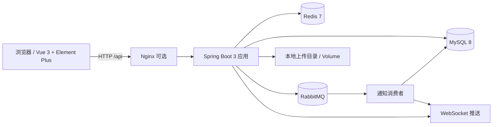

# 校园活动报名与场地预约平台

面向校园场景的活动发布、报名、候补、场地预约和签到平台。项目采用前后端分离架构，后端提供 REST API，前端提供按角色区分的操作界面。

> 这是一个完整的课程/个人项目，不是生产级系统。并发、部署和监控部分用于演示工程化流程，真实生产环境还需要补充安全审计、分布式锁、对象存储、告警和容量规划。

- 后端：Spring Boot 3 + MyBatis + MySQL 8 + Redis + RabbitMQ
- 前端：Vue 3 + Vite + Element Plus + Pinia + Vue Router
- 部署：Docker Compose / 多阶段 Dockerfile / GitHub Actions
- 文档：Swagger UI / Actuator / Prometheus 指标

---

## 1. 功能概览

### 角色与权限

| roleId | 角色 | 主要能力 |
| --- | --- | --- |
| 1 | 系统管理员 | 活动审核、全部活动、用户管理、社团管理、场地与时段管理 |
| 2 | 社团管理员 | 发布/编辑活动、提交审核、查看报名名单、签到、预约场地 |
| 3 | 场地管理员 | 场馆与时段管理、预约管理、强制取消预约 |
| 4 | 学生 | 浏览活动、报名/候补、取消报名、查看电子票、通知、个人中心 |

后端在接口层再次校验角色；前端根据 `roleId` 控制菜单和路由。

### 核心流程

```text
社团管理员创建活动 → 提交审核 → 管理员审核通过 → 活动发布
        → 学生报名（满员进入候补）→ 取消/候补转正 → 签到
社团管理员预约场地 → 提交预约 → 场地管理员审核/管理
管理员维护用户、社团、场馆和时段
```

### 页面

- 登录/注册、首页概览
- 活动广场、活动详情、报名、我的报名/电子票
- 社团活动管理、活动表单、报名名单、CSV 导出、签到
- 场地预约、预约草稿提交/取消
- 场馆与时段管理、预约管理
- 管理员活动审核、全部活动、用户管理、社团管理
- 通知中心、个人中心（资料、头像、密码）

---

## 2. 技术架构



### 后端模块

```text
com.campus
├── controller       REST 接口、角色校验
├── service          业务逻辑
├── mapper           MyBatis Mapper / XML
├── entitys          实体、Result、PageBean
├── vo               接口返回 VO
├── config           拦截器、WebSocket、RabbitMQ、跨域
├── interceptors     JWT + Redis 登录校验
├── scheduled_task   活动状态、报名状态定时任务
├── webSocket        通知推送
└── utils            JWT、当前用户、文件校验
```

### 关键设计

- JWT + Redis：登录后 token 写入 Redis，拦截器同时校验 JWT 和 Redis 中的登录态。
- 角色权限：`role_id` 对应管理员、社团管理员、场地管理员、学生。
- 分页：PageHelper + `PageBean<T>`。
- 报名幂等：请求头 `Idempotency-Key` + Redis/数据库约束，避免重复报名。
- 并发控制：数据库唯一约束和事务保证名额、时段不被重复占用。
- 异步通知：业务写入 outbox，RabbitMQ 消费者落库并通过 WebSocket 推送。
- 定时任务：自动推进活动状态、处理报名/候补状态。

---

## 3. 业务状态机

### 活动状态

```text
草稿 → 待审核 → 已发布 → 报名中 → 报名已结束 → 已开始 → 已结束
          ↘ 被驳回 → 修改后重新提交
待审核 / 已发布 / 报名中 → 已取消
```

### 报名状态

```text
成功 / 候补 → 已签到 / 未出席
成功 / 候补 → 取消
```

### 预约与时段

```text
预约：草稿 → 已通过 → 已取消
            ↘ 已驳回

时段：OPEN → BOOKED
       OPEN → CLOSED
```

> 预约状态和时段状态分开维护：预约通过后占用时段；取消/强制取消后释放时段。

---

## 4. 快速开始（本地）

### 环境要求

- JDK 17
- Maven 3.8+
- Node.js 22+
- MySQL 8
- Redis 7
- RabbitMQ 3（通知功能需要）

### 1. 配置环境变量

```bash
cd E:\Java\IDEA\project\campus
copy .env.example .env
```

在 `.env` 中填写：

| 变量 | 说明 |
| --- | --- |
| `JWT_SECRET` | JWT 签名密钥，至少 32 位随机字符串 |
| `DB_PASSWORD` | MySQL 密码 |
| `REDIS_PASSWORD` | Redis 密码 |
| `RABBITMQ_USER` / `RABBITMQ_PASSWORD` | RabbitMQ 账号 |
| `REAL_PATH_AVATAR` / `REAL_PATH_LOGO` / `REAL_PATH_COVER` | 本地上传文件目录 |
| `WEB_PREFIX_AVATAR` / `WEB_PREFIX_LOGO` / `WEB_PREFIX_COVER` | 浏览器访问前缀 |

`.env` 已被 `.gitignore` 忽略，不要提交。

### 2. 启动依赖

先启动 MySQL、Redis、RabbitMQ：

```text
MySQL:    localhost:3306
Redis:    localhost:6379
RabbitMQ: localhost:5672
```

创建数据库：

```sql
CREATE DATABASE campus_dev
  DEFAULT CHARACTER SET utf8mb4
  COLLATE utf8mb4_unicode_ci;
```

Flyway 脚本位于：

```text
src/main/resources/db/migration/
├── V1__init_schema.sql
└── V2__init_data.sql
```

应用启动时会自动执行迁移。初始管理员账号为：

```text
username: admin
password: 123456
```

首次登录后请立即修改密码。

### 3. 启动后端

```bash
cd E:\Java\IDEA\project\campus
mvn spring-boot:run
```

默认地址：

```text
API:      http://localhost:8080
Swagger:  http://localhost:8080/swagger-ui.html
API Docs: http://localhost:8080/v3/api-docs
Health:   http://localhost:8080/actuator/health
Metrics:  http://localhost:8080/actuator/prometheus
```

### 4. 启动前端

```bash
cd E:\Java\vue\projcet\campus_front
npm install
npm run dev
```

访问：

```text
http://localhost:5173
```

开发服务器将 `/api` 代理到 `http://localhost:8080`。

生产构建：

```bash
npm run build
```

产物在 `dist/`。

---

## 5. Docker Compose 部署

`docker-compose.yml` 包含：

- `mysql`：MySQL 8，`campus_dev` 数据库
- `redis`：Redis 7
- `rabbitmq`：RabbitMQ 3.13，带管理界面
- `app`：Spring Boot 应用
- 数据卷：`mysql-data`、`redis-data`、`rabbitmq-data`、`upload-data`

### 启动

```bash
cd E:\Java\IDEA\project\campus
copy .env.example .env
# 修改 .env 中的密码和 JWT_SECRET
docker compose up -d --build
docker compose ps
```

服务端口：

```text
MySQL:      3306
Redis:      6379
RabbitMQ:   5672 / 15672
Backend:    8080
```

上传目录挂载到 `upload-data`，容器内路径：

```text
/data/www/uploads/avatar/
/data/www/uploads/logo/
/data/www/uploads/cover/
```

`docker-compose.yml` 已经通过环境变量覆盖了 Windows 本地路径，容器内不会使用 `E:\...`。

查看日志：

```bash
docker compose logs -f app
```

停止：

```bash
docker compose down
```

> 首次启动时 Flyway 会自动建表和初始化管理员账号。MySQL 健康检查通过后 app 才会启动。

---

## 6. Nginx / HTTPS（可选）

前端 `dist/` 可以交给 Nginx 托管，后端 `/api` 反向代理。

```nginx
server {
    listen 80;
    server_name campus.example.com;

    root /usr/share/nginx/html;
    index index.html;

    client_max_body_size 6m;

    location / {
        try_files $uri $uri/ /index.html;
    }

    location /api/ {
        proxy_pass http://127.0.0.1:8080/;
        proxy_set_header Host $host;
        proxy_set_header X-Real-IP $remote_addr;
        proxy_set_header X-Forwarded-For $proxy_add_x_forwarded_for;
    }

    location /uploadAvatar/ {
        proxy_pass http://127.0.0.1:8080;
    }

    location /uploadLogo/ {
        proxy_pass http://127.0.0.1:8080;
    }

    location /uploadCover/ {
        proxy_pass http://127.0.0.1:8080;
    }
}
```

HTTPS 可以使用 certbot：

```bash
certbot --nginx -d campus.example.com
```

上传接口限制为 5MB，`client_max_body_size 6m` 留出了表单开销。

---

## 7. 接口清单

所有接口返回统一结构：

```json
{
  "code": 200,
  "msg": "操作成功",
  "data": {}
}
```

`code=200` 表示成功；错误码见 `ErrorCode`。

### 用户与认证

| 方法 | 路径 | 说明 |
| --- | --- | --- |
| POST | `/user/register` | 学生注册 |
| POST | `/user/login` | 登录，返回 JWT |
| DELETE | `/user/deleteToken` | 退出登录 |
| GET | `/user/info` | 当前用户信息 |
| PUT | `/user/update` | 修改资料 |
| PATCH | `/user/updatePassword` | 修改密码 |
| GET | `/user/list` | 用户列表（管理员） |
| PUT | `/user/updateRole` | 修改角色（管理员） |
| PUT | `/user/updateClub` | 修改所属社团（管理员） |
| PUT | `/user/disable` / `/user/enable` | 禁用/启用用户（管理员） |

### 活动

| 方法 | 路径 | 说明 |
| --- | --- | --- |
| GET | `/activity/list` | 全部活动（管理员） |
| GET | `/activity/listforstudent` | 学生活动列表 |
| GET | `/activity/listforclub` | 本社团活动（社团管理员） |
| GET | `/activity/detail` | 活动详情 |
| POST | `/activity/add` | 创建活动（社团管理员） |
| PUT | `/activity/update` | 编辑活动（草稿/被驳回） |
| PATCH | `/activity/submit` | 提交审核 |
| PATCH | `/activity/audit` | 审核通过（管理员） |
| PUT | `/activity/reject` | 驳回活动（管理员） |
| PATCH | `/activity/cancel` | 取消活动（社团管理员） |
| DELETE | `/activity/delete` | 删除活动（管理员/社团管理员） |

### 报名与签到

| 方法 | 路径 | 说明 |
| --- | --- | --- |
| POST | `/registration/add` | 报名，需要 `Idempotency-Key` |
| PUT | `/registration/cancel` | 取消报名 |
| PUT | `/registration/confirm` | 确认报名状态 |
| GET | `/registration/list` | 活动报名列表（社团管理员） |
| GET | `/registration/listforStudent` | 我的报名 |
| GET | `/registration/export` | 导出报名 CSV |
| POST | `/checkin/add` | 创建签到记录 |
| PUT | `/checkin/checkin` | 按票号签到 |
| GET | `/checkin/count` | 签到统计 |

### 场地与预约

| 方法 | 路径 | 说明 |
| --- | --- | --- |
| GET | `/venues/list` | 场馆列表 |
| GET | `/venues/detail` | 场馆详情 |
| POST | `/venues/add` | 新增场馆（管理员/场地管理员） |
| PUT | `/venues/update` | 编辑场馆 |
| DELETE | `/venues/delete` | 删除场馆 |
| PUT | `/venues/disable` | 禁用场馆 |
| POST | `/venueSlots/assign` | 生成未来 14 天时段（场地管理员） |
| GET | `/venueSlots/list` | 时段列表 |
| PUT | `/venueSlots/close` | 关闭时段 |
| POST | `/booking/add` | 创建预约草稿（社团管理员） |
| PUT | `/booking/submit` | 提交预约 |
| PUT | `/booking/cancel` | 取消预约 |
| PUT | `/booking/cancelByVenueAdmin` | 强制取消（场地管理员） |
| GET | `/booking/listForClubAdmin` | 本社团预约 |
| GET | `/booking/list` | 全部预约（场地管理员） |

### 社团、通知、上传

| 方法 | 路径 | 说明 |
| --- | --- | --- |
| GET | `/club/list` | 社团列表 |
| GET | `/club/detail` | 社团详情 |
| POST | `/club/add` | 创建社团（管理员） |
| PUT | `/club/update` | 编辑社团 |
| PATCH | `/club/disable` / `/club/enable` | 禁用/启用社团 |
| PUT | `/club/assignAdmin` | 分配社团管理员 |
| GET | `/notification/list` | 通知列表 |
| GET | `/notification/read` | 标记已读 |
| GET | `/notification/readAll` | 全部已读 |
| POST | `/upload/uploadAvatar` | 上传头像 |
| POST | `/upload/uploadLogo` | 上传社团 Logo |
| POST | `/upload/uploadCover` | 上传活动封面 |

> 完整参数和示例可在 Swagger UI 中查看。

---

## 8. Swagger、Actuator 与 Prometheus

- Swagger UI：`/swagger-ui.html`
- OpenAPI JSON：`/v3/api-docs`
- 健康检查：`/actuator/health`
- Prometheus 指标：`/actuator/prometheus`

<p align="center">
  
</p>

<p align="center">
  
  
</p>

生产环境建议：

- 只暴露 `health,info,prometheus`，不要暴露全部端点；
- 用 Nginx 限制 `/actuator` 的访问来源；
- 接入 Prometheus + Grafana，关注 JVM、HTTP、Hikari、Redis 和业务指标；
- 不要把 `management.endpoint.health.show-details` 设为 `always` 暴露给公网。

---

## 9. 测试与 CI

### 本地测试

```bash
cd E:\Java\IDEA\project\campus
mvn test
```

当前测试结果：

```text
Tests run: 29, Failures: 0, Errors: 0, Skipped: 0
BUILD SUCCESS
```

测试覆盖：

- Controller 层：活动、预约、签到
- Service 层：报名、候补、取消、幂等
- 集成测试：登录/权限/业务主流程（MockMvc + MockBean）
- 并发测试：`ConcurrencyTest`（默认通过 Surefire `excludedGroups=concurrency` 排除，需要真实 MySQL 时手动运行）

<p align="center">
  
</p>

### GitHub Actions

`.github/workflows/ci.yml` 会执行：

```text
mvn clean test
docker build -t campus-app:test .
```

测试使用 H2 内存数据库，不依赖 CI 环境中的 MySQL。

<p align="center">
  
</p>

---

## 10. 压测结果

> 压测环境为单机环境，JMeter 与后端在同一台机器上运行，结果仅代表本机参考值，不等同于生产容量。测试截图位于 `docs/screenshots/`。

### 10.1 2000 请求抢 100 个名额 + 20 个候补

配置：2000 threads，Ramp-up 10s，循环 1 次，CSV 提供 token 和 `Idempotency-Key`。

| 指标 | 结果 |
| --- | --- |
| 请求数 | 2000 |
| 成功报名 | 100 |
| 候补 | 20 |
| 剩余名额 | 0 |
| 超卖 | 0 |
| 平均响应 | 3 ms |
| P95 | 6 ms |
| P99 | 7 ms |
| 吞吐量 | 198.6 req/s |
| HTTP 错误率 | 0.00% |

说明：JMeter 报告中的 HTTP 错误率为 0%，不代表 2000 人都报名成功；未抢到名额的请求按“满员/候补满”业务错误返回，业务结果以数据库统计为准。

<p align="center">
  
  
</p>

<p align="center">
  
  
  
</p>

### 10.2 500 请求抢 1 个预约时段

配置：500 threads，Ramp-up 10s，循环 1 次，同一个 `slotId`。

| 指标 | 结果 |
| --- | --- |
| 请求数 | 500 |
| 已通过预约 | 1 |
| 草稿预约 | 499 |
| 平均响应 | 8 ms |
| P95 | 11 ms |
| P99 | 12 ms |
| 吞吐量 | 50 req/s |
| HTTP 错误率 | 0.00% |

说明：该场景当前每次请求先创建一条“草稿”预约，最终只有 1 条被提交为“已通过”，因此数据库中是 **1 条已通过 + 499 条草稿**。这说明预约创建层没有阻止同一用户重复创建草稿，属于当前实现限制；如果要表达“500 人抢 1 个时段”，需要把创建与提交合并，或在创建时直接做时段占用判断。

<p align="center">
  
  
</p>

<p align="center">
  
</p>

### 10.3 300 QPS 活动详情查询

目标：300 QPS，持续约 2 分钟，查询活动详情。

| 指标 | 结果 |
| --- | --- |
| 请求数 | 39,930 |
| 失败数 | 0 |
| 错误率 | 0.00% |
| 平均响应 | 10.76 ms |
| P90 | 11 ms |
| P95 | 11 ms |
| P99 | 12 ms |
| 吞吐量 | 333.28 req/s |
| 接收流量 | 2,415.25 KB/s |

<p align="center">
  
  
</p>

---

## 11. 界面截图

<p align="center">
  
</p>

<p align="center">
  
</p>

<p align="center">
  
  
</p>

<p align="center">
  
  
</p>

<p align="center">
  
  
</p>

<p align="center">
  
  
</p>

<p align="center">
  
  
</p>

---

## 12. 已知限制

1. **不是生产级系统**：没有完整的审计、告警、备份、灰度、密钥管理和容量规划。
2. **单机部署**：MySQL、Redis、RabbitMQ 和应用都在本地/Docker 单机，未验证集群和高可用。
3. **并发控制依赖数据库约束**：当前通过唯一键、事务和名额扣减保证不超卖；没有引入分布式锁。
4. **预约草稿问题**：同一用户可以对同一时段创建多条草稿，压测中出现了 499 条草稿；需要在创建预约时增加业务校验。
5. **管理员预约权限**：`/booking/list` 只允许场地管理员，管理员前端菜单不显示“预约管理”；如果管理员需要查看全部预约，需要后端放开角色。
6. **上传文件存本地**：Avatar/Logo/Cover 保存在本地磁盘或 Docker volume，没有接入 OSS/S3。
7. **历史封面地址**：数据库中部分 `cover_url` 是历史短链，可能无法解析；前端做了渐变占位，但不代表图片可用。
8. **测试覆盖有限**：29 个测试通过，但主要是 Controller/Service/集成测试，覆盖率不是生产标准。
9. **默认管理员密码**：V2 种子数据中 `admin/123456` 仅用于初始化，部署后必须修改。
10. **HTTPS 未内置**：Nginx/HTTPS 需要按实际域名配置，仓库只提供示例配置。

---

## 13. 目录结构

```text
campus/
├── src/main/java/com/campus/
│   ├── controller/
│   ├── service/
│   ├── mapper/
│   ├── entitys/
│   ├── vo/
│   ├── config/
│   ├── interceptors/
│   ├── scheduled_task/
│   ├── webSocket/
│   └── utils/
├── src/main/resources/
│   ├── application.yml
│   ├── application-dev.yml
│   ├── db/migration/
│   │   ├── V1__init_schema.sql
│   │   └── V2__init_data.sql
│   └── com/campus/mapper/
├── src/test/                 单元/集成/并发测试
├── docs/screenshots/         README 截图
├── Dockerfile
├── docker-compose.yml
├── .github/workflows/ci.yml
├── .env.example
└── pom.xml
```

前端项目在独立目录 `campus_front/`，包含 Vue 3 页面、路由守卫、API 封装和基于 `roleId` 的动态菜单。

---

## 14. 说明

- 前端源码：`campus_front/`（Vue 3 + Vite + Element Plus）
- 后端源码：本仓库
- 截图：`docs/screenshots/`
- 压测截图：`docs/screenshots/2000抢120(20为候补)/`、`docs/screenshots/500抢1预约/`、`docs/screenshots/300QPS/`
- 更详细的前端说明见 `campus_front/README.md`

如果这个项目对你有帮助，欢迎 Star 或提交 Issue。
